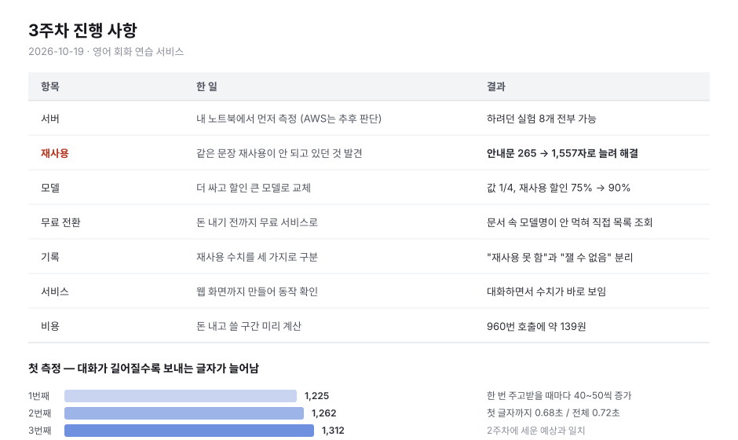

# 3주차

2026-10-19 ~ 10-21 (과제 기한 연장)

---

## 용어

- **토큰** — AI가 글자를 세는 단위. 영어 기준 대략 4글자 = 1토큰. 보낸 양과 받은 양으로 요금이 매겨짐
- **안내문(시스템 프롬프트)** — 매 요청마다 AI에게 먼저 주는 지시문
- **재사용(프롬프트 캐싱)** — 앞서 보낸 것과 똑같은 앞부분은 다시 계산하지 않고 재활용. 요금이 최대 90% 깎임
- **대화 기록 전달 방식** — AI는 이전 대화를 기억하지 못해 매번 전체를 다시 보내야 함. 무엇을 다시 보낼지 정하는 방식
- **추론 토큰** — 추론 모델이 답을 만들기 전에 내부적으로 쓰는 토큰. 화면에 안 보이지만 과금됨

---

## 1. 이번 주에 한 일

### 1. 내 노트북에서 먼저 측정하기로

- 하려던 실험 8개를 적어놓고 AWS가 꼭 필요한지 확인 → 8개 전부 노트북에서 가능
- 결정 이유: 설정 하나 바꿀 때마다 AWS에 올려야 해서 실험 반복이 느림
- **AWS 배포 여부는 아직 안 정함.** 로컬 측정을 끝낸 뒤 올려볼 예정
- AWS에 올려야 잴 수 있는 것 4개: 서버가 처음 깨어날 때 지연, 메모리 증설 효과, 서버 사용 요금, 29초 응답 제한

### 2. 재사용이 전혀 안 되고 있던 것 발견

- 재사용은 앞부분이 **1,024토큰 이상**이어야 작동 (OpenAI 문서)
- 내 요청은 대화를 10번 주고받아도 265토큰 → 조건 미달로 한 번도 안 걸림
- 원인: 계획은 세웠는데 그 계획이 돌아가는 조건을 확인 안 함

**조치**

- 안내문을 4줄에서 다시 작성 (역할, 학습자 수준, 대화 규칙, 교정 방침, 좋은/나쁜 예시)
- 1,340토큰이 되어 첫 대화부터 조건 충족

**추가로 알게 된 것**

- 재사용은 앞부분이 한 글자라도 다르면 전부 무효
- 상황 설정을 안내문 안에 넣으면 상황 20개마다 앞부분이 달라져 재사용이 전혀 안 됨 → 밖으로 분리

### 3. 모델 교체

- `gpt-4.1-mini` → `gpt-6-luna`. 보내는 글자 요금 1/4, 재사용 할인 75% → 90%
- 기존 모델은 보관. 모델별 할인율 비교용

### 4. 무료 서비스로 전환

- 결제 전이라 Groq 무료 요금제 사용. 접속 주소만 바꾸면 되므로 코드 수정 거의 없음
- 문서에 적힌 모델 이름이 404 → 계정에 직접 목록을 조회해 교체
- 인증 실패(401)가 아니라 "모델 없음"이었음. 문서가 아니라 계정에 물어봐야 함

### 5. 재사용 수치 구분 방식 수정

처음 몇 건에서 재사용 수치가 비어 있었음. 0으로 처리하면 두 가지가 같은 값이 됨.

| 값 | 뜻 |
|---|---|
| 숫자 | 재사용됨 |
| 0 | 재사용 안 됨 |
| 없음 | 잴 수 없음 |

### 6. 서비스 완성

- 노트북에서 도는 웹 서버 + 대화 화면. 외부 라이브러리 1개만 사용
- 상황 20개 선택, 글자가 하나씩 나오는 방식 켜고 끄기, 전달 방식 바꾸기 모두 화면에서 가능
- 대화할 때마다 측정값이 화면에 바로 표시됨

### 7. 측정 방법 정리

- 매 요청마다 파일에 한 줄씩 기록 (조건 / 글자 수 / 걸린 시간)
- 걸린 시간은 셋으로 나눠 기록 — 첫 글자까지, AI 호출 전체, 내 서버 처리 전체
- 나눈 이유: 느린 원인이 AI 쪽인지 내 코드 쪽인지 구분하려고
- 비교 조건: 같은 질문 묶음을 같은 순서로, 한 번에 설정 하나만 변경, 측정마다 버전 표시
- 비용은 재는 게 아니라 기록된 글자 수에 단가를 곱해 계산. 요약 방식은 요약 호출 비용도 더해야 함

### 8. 품질 채점기 구현

- 지금까지 비용·속도만 재고 품질은 안 쟀음. 토큰을 줄여도 품질이 떨어지면 개선이 아님
- `src/score.js` — 안내문에 적힌 규칙 9개를 자동 채점
- 영어만 사용 / 1~3문장 / 질문 포함 / 이모지 없음 / 마크다운 없음 / 지문 표기 없음 / 역할 유지 / 대화 중 교정 없음 / 빈 응답 아님

### 9. 기억 테스트 구현

- 앞 대화에 구체적 사실을 심고, 그 사실이 전달 범위 밖으로 밀려난 뒤 되물음
- 우연히 맞힐 수 없는 값으로 선정 (이름 Minji, 항공편 AB1423, 주문번호 7781 등)
- `bench/generate-probes.mjs` — 상황 10개 × 깊이 2/6/12 = 30건
- 판정 4단계

| 판정 | 뜻 |
|---|---|
| 기억 | 심어둔 사실을 기억 |
| 날조 | 같은 종류의 다른 값을 지어냄 |
| 되물음 | 모른다고 되물어옴 |
| 애매 | 해당 없음 |

### 10. 측정 자동화와 보고서 스킬

- `bench/sweep.mjs` — 같은 입력에 전달 방식만 바꿔 호출, 비용과 품질 동시 기록
- `bench/analyze.mjs` — 집계 표 + CSV 출력
- `.claude/skills/weekly-report/` — 보고서 작성 스킬. 숫자를 측정 파일에서 직접 읽도록 강제

---

## 2. 결과

근거: `bench/results/w03-repeat3.json` (3회 반복, 270건 중 221건 성공), `runs/dev.jsonl`

1회 측정으로 먼저 비교한 뒤 3회 반복으로 다시 쟀다. 결론이 하나 뒤집혔다.

### 대화가 길어질수록 보내는 양이 늘어남

| 횟수 | 보낸 글자 | 받은 글자 | 걸린 시간 |
|---|---|---|---|
| 1번째 | 1,225 | 41 | 0.89초 |
| 2번째 | 1,262 | 91 | 0.70초 |
| 3번째 | 1,312 | 79 | 0.70초 |

- 한 번 주고받을 때마다 40~50토큰씩 증가. 2주차 예상과 일치
- 첫 글자까지 0.68초, 전체 0.72초

### 대화 기록 전달 방식 3종 비교

3회 반복 (전체·최근만 각 90건, 요약 41건)

| 방식 | n | 보낸 글자 | 받은 글자 | 요약 | 요청당 비용 | 기억 | 날조 | 되물음 | 애매 |
|---|---|---|---|---|---|---|---|---|---|
| 전체 | 90 | 1,380 | 150 | 0 | $0.000167 | 92% | 0% | 0% | 7% |
| 최근만 | 90 | 1,258 | 169 | 0 | $0.000145 | 8% | 21% | 21% | 42% |
| 요약 | 41 | 1,305 | 139 | 476 | $0.000280 | 80% | 0% | 2% | 15% |

전체 대비 — 최근만: 보낸 글자 -9%, 비용 **-14%**, 기억 92% → 8%

### 차이가 변동폭보다 큰가

반복 측정의 목적은 평균이 아니라 **차이가 흔들림 안에 들어가는지** 확인하는 것이다.

| 비교 | 차이 | 회차 간 변동폭 | 판정 |
|---|---|---|---|
| 기억률 | 84.3%p | 14.0 | 유의 |
| 보낸 글자 | 122 | 0.0 | 유의 |
| 요청당 비용 | 22.7µ$ | 10.4 | 유의 |
| 규칙 통과율 | 2.3%p | 10.0 | **변동폭 안. 결론 불가** |

규칙 통과율은 방식에 따라 달라진다고 말할 수 없다.

### 확인된 것

**최근만 보내기는 비용을 14% 줄임. 대신 기억을 거의 다 잃음**

- 보낸 글자 9% 감소, 요청당 비용 14% 감소. 둘 다 변동폭을 넘어 유의
- 기억률은 92% → 8%
- 받은 글자는 150 → 169 로 늘어남. 맥락이 없으면 되묻거나 지어내느라 더 길게 답함
- 받는 쪽 단가가 보내는 쪽의 5배라 보낸 글자 절감분이 일부 상쇄되지만, 상쇄하고도 14% 남음

1회 측정에서는 비용 차이가 1% 로 나왔다. 3회 반복에서 -14% 로 바뀌었다.
1회 측정값이 노이즈였고, 그걸 결론으로 썼으면 틀렸을 것이다.

**모를 때 모른다고 하지 않고 지어냄**

- 최근만 보내기에서 날조 21%, 되물음 21%, 애매 42%
- 1회 측정에서는 날조 33%, 되물음 13% 였다. 비율은 흔들리지만 날조가 사라지지는 않음
- 실제 사실: 항공편 AB1423
- 실제 응답: `Your flight is AB123, scheduled to depart at 08:45 AM from Gate 12.`
- 첫 채점기는 이를 애매로 통과시켰음. 실제 응답을 읽고 판정을 4단계로 재설계

**대화가 길어질수록 격차 확대**

| 깊이 | 전체 | 최근만 | 요약 |
|---|---|---|---|
| 2 | 93% | 7% | 87% |
| 6 | 83% | 7% | 79% |
| 12 | 100% | 10% | 75% |

전체 방식의 깊이 6 기억률 83% 는 회차 간 흔들림(변동폭 14) 안이다. 깊이가 깊어질수록
떨어진다고 말할 근거는 아직 없다.

**요약은 기억을 지키지만 비용이 증가** — 기억 80%, 비용 +67%

단, **요약 수치는 신뢰할 수 없다.** 90건 중 41건만 성공했다.
Groq 일일 토큰 한도(200,000)에 걸려 49건이 429 로 실패했다.
요약 방식은 요약 호출이 추가되어 호출당 토큰을 두 배 가까이 쓰기 때문에
한도가 소진되자 먼저 막혔다. 비용 변동폭도 µ$241.98 ~ 316.55 (폭 74.57) 로
전체 방식(10.38)의 7배다. 한도 회복 후 재측정이 필요하다.

**받은 글자의 대부분이 추론 토큰**

| 방식 | 받은 글자 | 그중 추론 | 비율 |
|---|---|---|---|
| 전체 | 136 | 103 | 76% |
| 최근만 | 184 | 154 | 84% |
| 요약 | 144 | 113 | 79% |

- 사용 중인 모델이 추론 모델. 화면에 보이는 텍스트는 16~24%뿐이지만 전액 과금
- 맥락이 적을수록 추론 비율 증가 (76% → 84%)
- 요약 호출도 받은 글자 267 중 추론 222 (83%)

**규칙 준수** — 전체 28/30, 최근만 26/30, 요약 24/30. 위반은 "질문으로 끝내기" 하나뿐

### 틀렸던 것

측정 전에 "무료 서비스는 재사용 수치를 반환하지 않는다"고 적었으나 틀림.

- 표본 6건만 보고 단정한 것이 원인
- 90건 측정: 처음 몇 건만 비고 이후 계속 적중. 53/90건(59%), 적중 시 보낸 글자의 74~81%
- 적중값이 768 / 1024 로만 나옴 → 1024 단위 블록 캐싱으로 추정
- 영향: 5주차에 유료 전환할 이유가 사라짐

### 측정 중 고친 버그

1. 서버가 구버전으로 실행 중이어서 요약 압축 코드가 반영되지 않음 → 요약과 최근만이 동일 결과
2. 요약 호출 상한이 추론 토큰에 소진되어 요약문이 빈 문자열 → 상한 상향, 빈 요약 감지 추가
3. 날조 탐지 패턴이 케이스에 복사되지 않아 미작동
4. 측정 스크립트가 추론 토큰 항목을 수집하지 않음

---

## 3. 예상과 결과

2주차에 적은 예상 (측정 전)

| 예상 | 실제 (3회 반복) | 맞음 |
|---|---|---|
| 최근만 보내면 비용이 크게 줄 것 | 비용 -14% (유의) | O |
| 최근만 보내면 앞부분을 잊을 것 | 기억 92% → 8% | O |
| 요약은 맥락 유지하며 토큰 절감 | 기억 80% 유지, 비용 +67% (표본 불완전) | 절반 |
| 모르면 되물을 것 | 날조 21%, 되물음 21% | 절반 |
| 무료 서비스는 재사용 수치를 안 줌 | 59% 적중 | X |
| 요약 호출이 추가 비용이 될 것 | 요약 476토큰, 비용 증가 | O |

1회 측정 직후에 적은 예상 (3회 반복 전)

| 예상 | 실제 | 맞음 |
|---|---|---|
| 기억률은 ±5%p 안에서 흔들릴 것 | 전체 폭 14%p, 최근만 폭 3%p | X |
| 비용 차이 1% 는 변동폭 안에 들어갈 것 | 차이 22.7µ$ > 변동폭 10.4. 유의 | X |
| 격차가 커서 결론은 안 바뀔 것 | 기억률 결론은 유지. 비용 결론은 뒤집힘 | 절반 |

**틀린 이유**

- 비용: 1회 측정의 -1% 를 실제 값으로 봤다. 노이즈였고 3회 반복에서 -14% 로 바뀌었다.
  "최근만 보내기는 비용을 줄이지 못한다" 는 결론을 쓸 뻔했다
- 되물음: 모델이 모르는 것을 인정한다고 가정했다. 실제로는 되묻는 만큼 지어낸다
- 재사용 수치: 표본 6건으로 단정했다. 90건에서는 반대 결과
- 기억률 변동폭: ±5%p 로 봤으나 전체 방식은 14%p 흔들렸다. 깊이별 비교에는 3회로도 부족하다

---

## 4. 공부한 것

**재사용(프롬프트 캐싱)**

- 앞부분이 최소 1,024토큰이어야 작동 — OpenAI 문서
- 앞부분이 한 글자라도 다르면 전체 무효 — 같은 문서
- 모델 세대별 캐시 수명이 다름. 최신은 30분 이상, 이전 세대는 5~10분
- 모델별 할인율이 다름. gpt-6-luna 90%, gpt-4.1-mini 75% — OpenAI 가격표
- Groq는 768 / 1024 단위로만 적중값을 보고 — 측정

**추론 모델의 토큰 구조**

- 추론 토큰이 받은 글자 수에 포함됨. 별도 항목이 아님
- 추론 토큰이 응답 길이 상한을 본문과 나눠 씀
- 상한을 200으로 두고 요약을 시켰더니 추론에 164를 쓰고 본문이 잘림 — 측정
- 받은 글자의 76~84%가 추론 토큰 — 측정
- 맥락이 적을수록 추론 비율이 올라감 — 측정

**공급자 전환**

- Groq, Gemini, Ollama가 OpenAI 호환 접속 주소를 제공. 주소만 바꾸면 코드 수정 없이 전환
- 문서에 있는 모델이 계정에는 없을 수 있음. 계정에 직접 조회해야 함 — 측정

**무료 요금제 한도**

- Groq 는 하루 토큰 한도가 있음. `openai/gpt-oss-20b` 기준 200,000 — 429 응답으로 확인
- 요약 방식은 호출당 토큰을 두 배 가까이 써서 한도 소진 시 먼저 막힘
- 270건 측정에 한도를 다 씀. 반복 측정을 하려면 한도를 먼저 계산해야 함

**측정 설계**

- 1회 측정은 결론으로 쓸 수 없음. 같은 입력에도 응답이 매번 달라짐 — 측정
- 평균보다 중요한 건 조건 간 차이가 회차 간 변동폭보다 큰지 — 측정
- 품질을 안 재면 비용 절감이 개선인지 손해인지 구분할 수 없음
- 자동 채점은 안내문에 명시된 규칙에서 그대로 가져오면 검증 가능한 항목이 됨
- 기억 테스트는 우연히 맞힐 수 없는 값을 심어야 판정이 명확함
- "모름"과 "날조"를 같은 값으로 처리하면 더 위험한 실패가 통계에서 사라짐

---

## 5. 다음 주 할 일

### 작업

1. 요약 방식 재측정. 일일 한도에 걸려 41/90 만 성공. 한도 회복 후 요약만 단독 실행
2. 측정 전 토큰 소요량 계산. 한도를 넘기면 중간에 끊김
3. 429 응답 시 재시도 또는 중단 처리 추가. 현재는 조용히 실패함
4. 질문 묶음 80건으로도 측정. 현재 규칙 준수율은 기억 테스트 30건 기준
5. 결과를 비용-품질 그래프로 정리

### 공부할 것

- Groq 재사용 적중 조건. 어떤 요청이 비고 어떤 요청이 적중하는지
- 추론 모델의 추론량 조절 가능 여부. 조절되면 비용 손잡이가 하나 늘어남
- 응답 변동을 다루는 반복 횟수 기준

### 예상

- 요약 방식을 온전히 재측정하면 비용은 전체 대비 +60~90% 사이일 것. 현재 +67% 는 표본이 깨진 값
- 요약 방식 기억률은 80% 근처일 것. 전체(92%)보다는 낮고 최근만(8%)보다는 훨씬 높을 것
- 80건의 규칙 준수율은 30건과 비슷할 것. 위반은 질문 누락 하나뿐일 것
- 재사용이 비는 41% 는 상황이 바뀌는 지점일 것. 앞부분이 달라져 캐시가 깨질 것

---

## 구현

| 파일 | 내용 |
|---|---|
| `src/score.js` | 규칙 9개 채점 + 기억 테스트 판정 4단계 |
| `src/llm.js` | 추론 토큰 추적, 요약 호출 상한 상향, 빈 요약 감지 |
| `src/record.js` | 추론 토큰 / 잘림 / 빈 요약 항목 추가 |
| `src/handler.js` | 요약 압축 통합 |
| `src/conversation.js` | 압축 대상 분리, 버린 대화 수 기록 |
| `bench/generate-probes.mjs` | 기억 테스트 30건 생성 |
| `bench/sweep.mjs` | 방식별 측정 |
| `bench/analyze.mjs` | 집계 |
| `.claude/skills/weekly-report/` | 보고서 작성 스킬 |

레포: https://github.com/SSONG22/its-study-5th

---

## 남은 문제

- 요약 방식 표본 불완전 (41/90). 일일 토큰 한도 소진
- 깊이별 비교는 3회로도 변동폭이 커서 결론 내기 어려움
- 시험용 대화가 같은 문장을 반복해서 씀 → 실제 사용보다 재사용률이 높게 나올 수 있음
- 영어 자체의 품질(문법, 자연스러움)은 측정하지 않음. 판정 모델이 필요하고 비용이 들어 범위 밖
